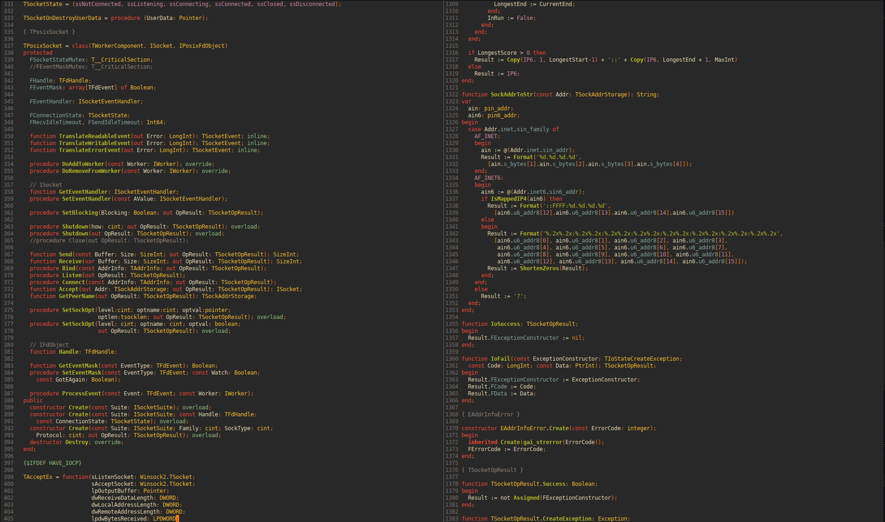
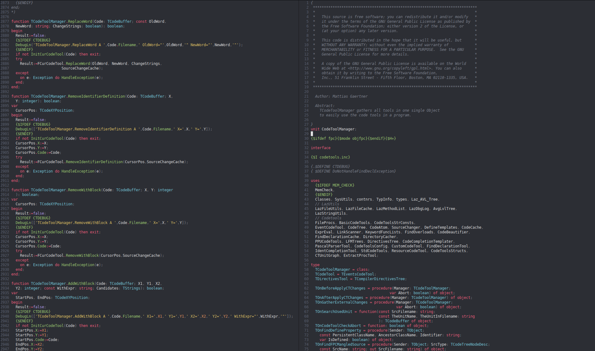
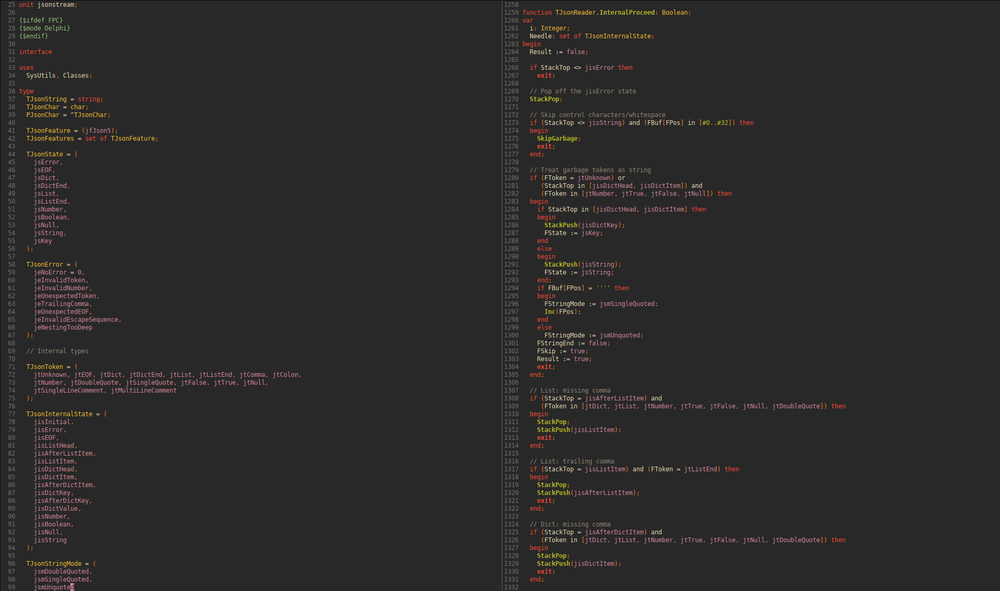
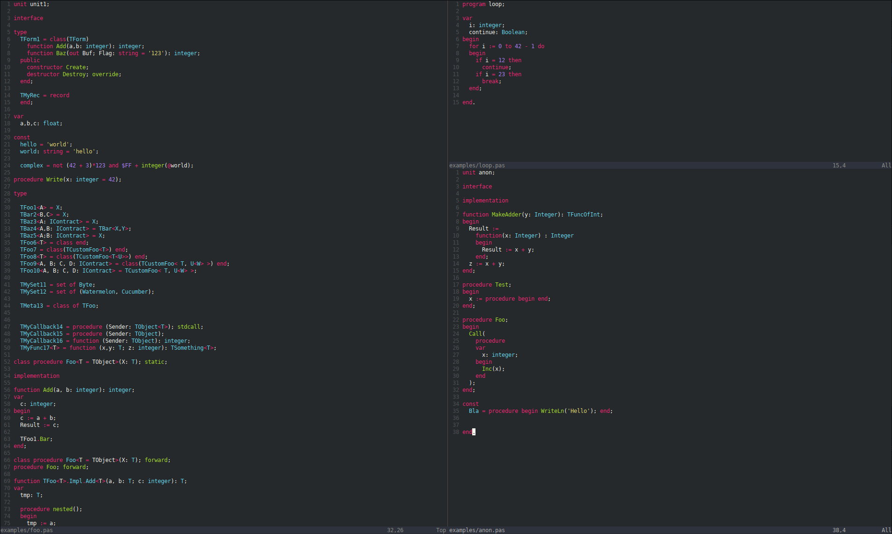

# tree-sitter-pascal

Grammar for Pascal and its dialects Delphi and Freepascal.

## Upstream and repository

This grammar originated as a fork of [Isopod/tree-sitter-pascal]. It is now
maintained in the canonical [lint4d monorepo], in `crates/tree-sitter-pascal`;
the workspace builds this in-tree crate. The former standalone
[`AntoineGS/tree-sitter-pascal`](https://github.com/AntoineGS/tree-sitter-pascal)
repository is not the canonical package repository and is no longer used by
the build.

The imported fork history was 56 commits beyond the upstream revision
`042119eca2e18a60e56317fb06ee3ba5c32cb447` at imported revision
`22cf861dc87bde0dd0b0d6397dd85dbef375006e`. This is a historical comparison
of those two revisions, not a claim that the current monorepo is 56 commits
ahead of upstream. Reproduce the count from a full-history clone containing
both revisions with:

```sh
git rev-list --count 042119eca2e18a60e56317fb06ee3ba5c32cb447..22cf861dc87bde0dd0b0d6397dd85dbef375006e
```

[Isopod/tree-sitter-pascal]: https://github.com/Isopod/tree-sitter-pascal
[lint4d monorepo]: https://github.com/AntoineGS/lint4d

## Supported language features
- Classes, records, interfaces, class helpers
- Nested declarations
- Variant records
- Generics (Delphi- & FPC flavored)
- Anonymous procedures & functions
- Inline assember (but no highlighting)
- Extended RTTI attributes
- FPC PasCocoa extensions
- Typed/inferred Delphi `for var ... in` iterators
- Delphi inline constants (`const X = 1;`, `const Y: Integer = 2;`) as `constDef`
- Delphi conditional expressions (`if ... then ... else ...`), `is not`, and `not in`
- Custom managed-record operators, including `const [ref]` parameters
- Binary literals (`%1010`, also in character codes) and FPC `case ... otherwise`
- Delphi digit separators (`1_000_000`, `$FFFF_FFFF`, `%1010_0101`)
- Delphi 12 multiline strings (`'''` or a longer odd run of quotes)

### Modern syntax and licensing

The modern syntax additions in this MIT-licensed fork are implemented independently
from language documentation, not copied from AGPL-licensed forks. References:

- [Delphi inline declarations](https://blogs.embarcadero.com/introducing-inline-variables-in-the-delphi-language/)
- [Delphi conditional expressions and precedence](https://blogs.embarcadero.com/coming-in-rad-studio-13-a-conditional-ternary-operator-for-the-delphi-language/)
- [Delphi 13 language features](https://blogs.embarcadero.com/rad-studio-13-every-new-and-enhanced-feature/)
- [Custom managed records](https://blogs.embarcadero.com/custom-managed-records-coming-to-delphi-10-4/)
- [FPC numeric literals](https://www.freepascal.org/docs-html/current/ref/refse6.html)
- [Delphi numerals and digit separators](https://docwiki.embarcadero.com/RADStudio/Florence/en/Fundamental_Syntactic_Elements_(Delphi))
- [Delphi multiline strings](https://blogs.embarcadero.com/yukon-beta-blog-delphi-language-modernizing-string-literals)
- [FPC case statements](https://www.freepascal.org/docs-html/ref/refsu56.html)

Existing syntax-tree shapes and structured preprocessor support are retained.
Conditional expressions use `exprConditional` with `condition`, `then`, and `else`
fields. Compound operators retain separate keyword nodes so comments between their
words remain visible.

The grammar recognizes syntax, not compiler semantics such as constant-expression
evaluation, managed-record operator signatures, or type compatibility.

## Tree-sitter features:
- Syntax highlighting
- Scopes

## Screenshots

(using nvim-treesitter)

<a href=".doc/scr1.png"></a>
<a href=".doc/scr2.png"></a>
<a href=".doc/scr3.png"></a>
<a href=".doc/scr4.png"></a>
